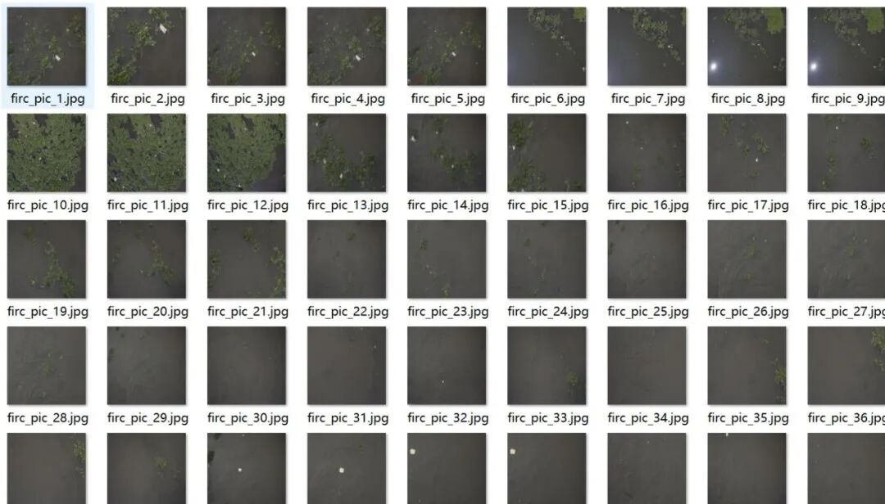
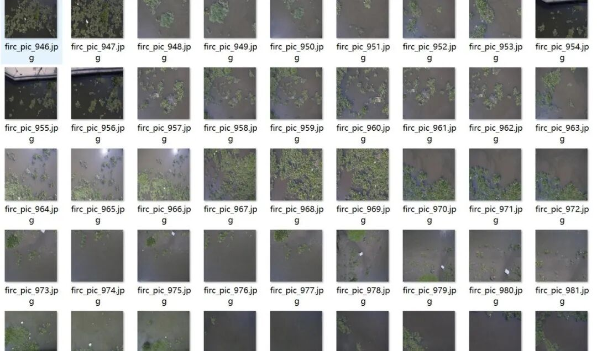
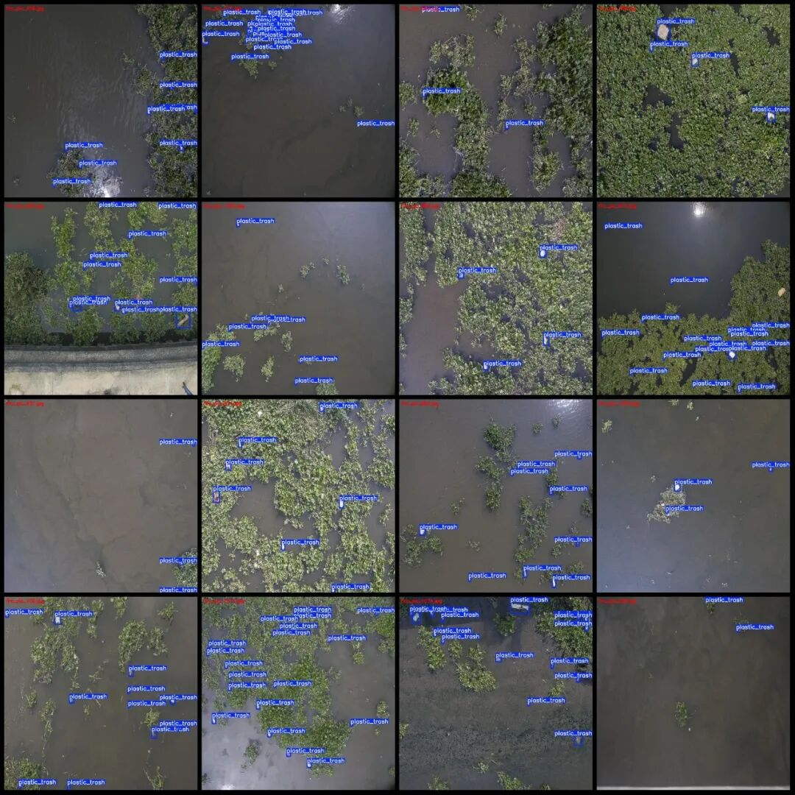
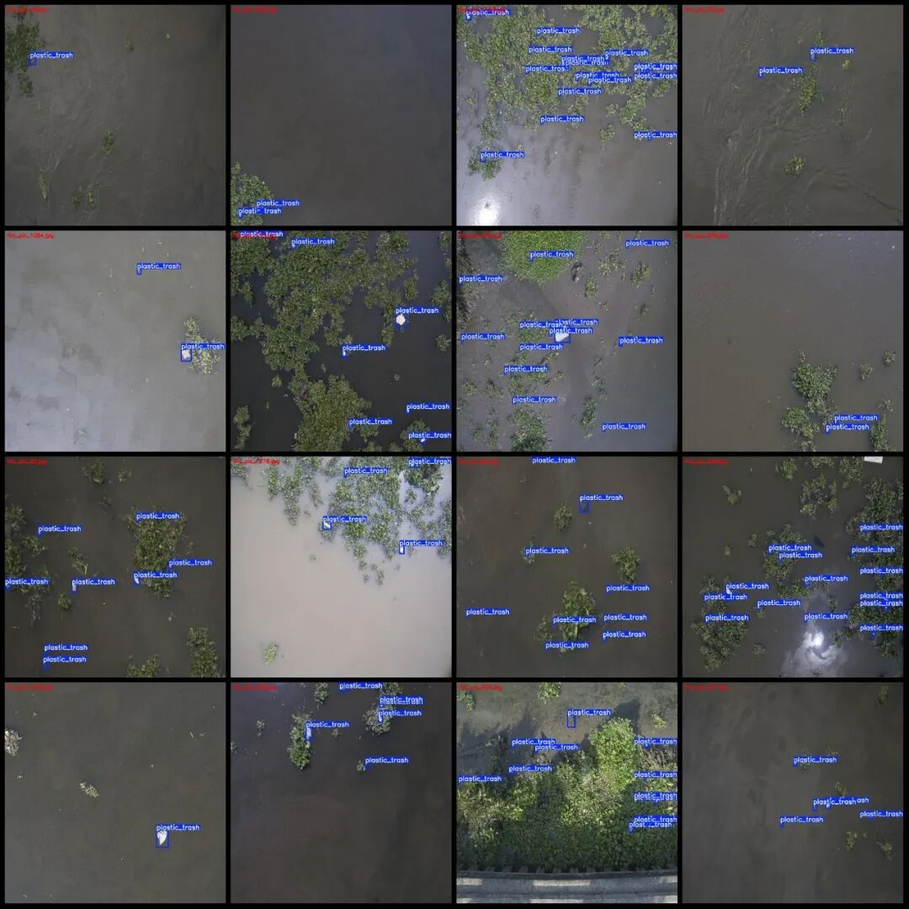
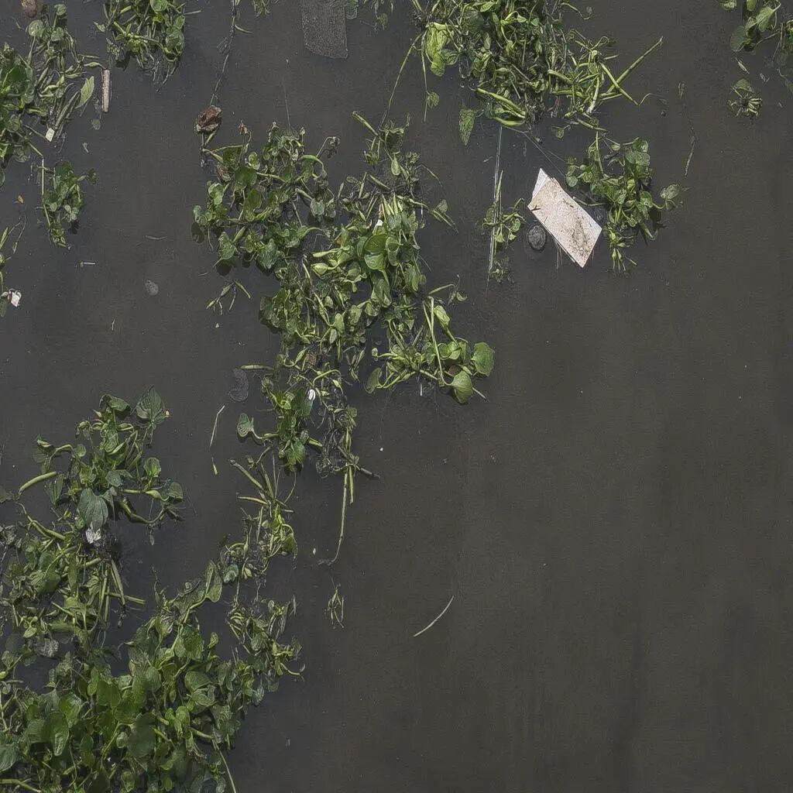
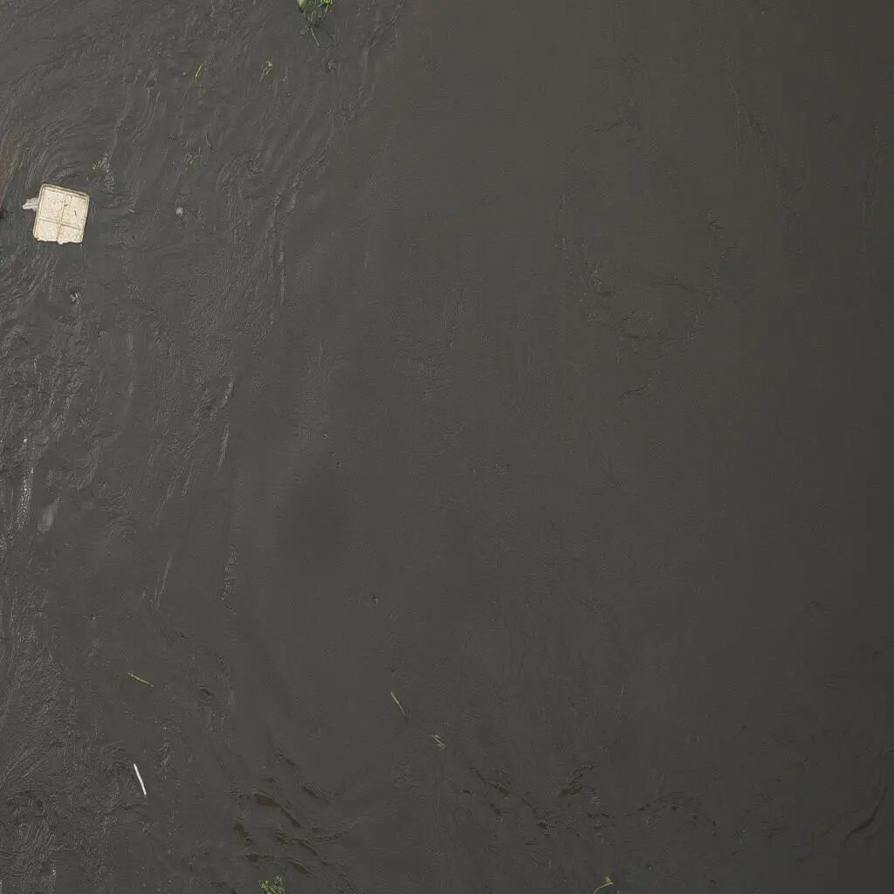
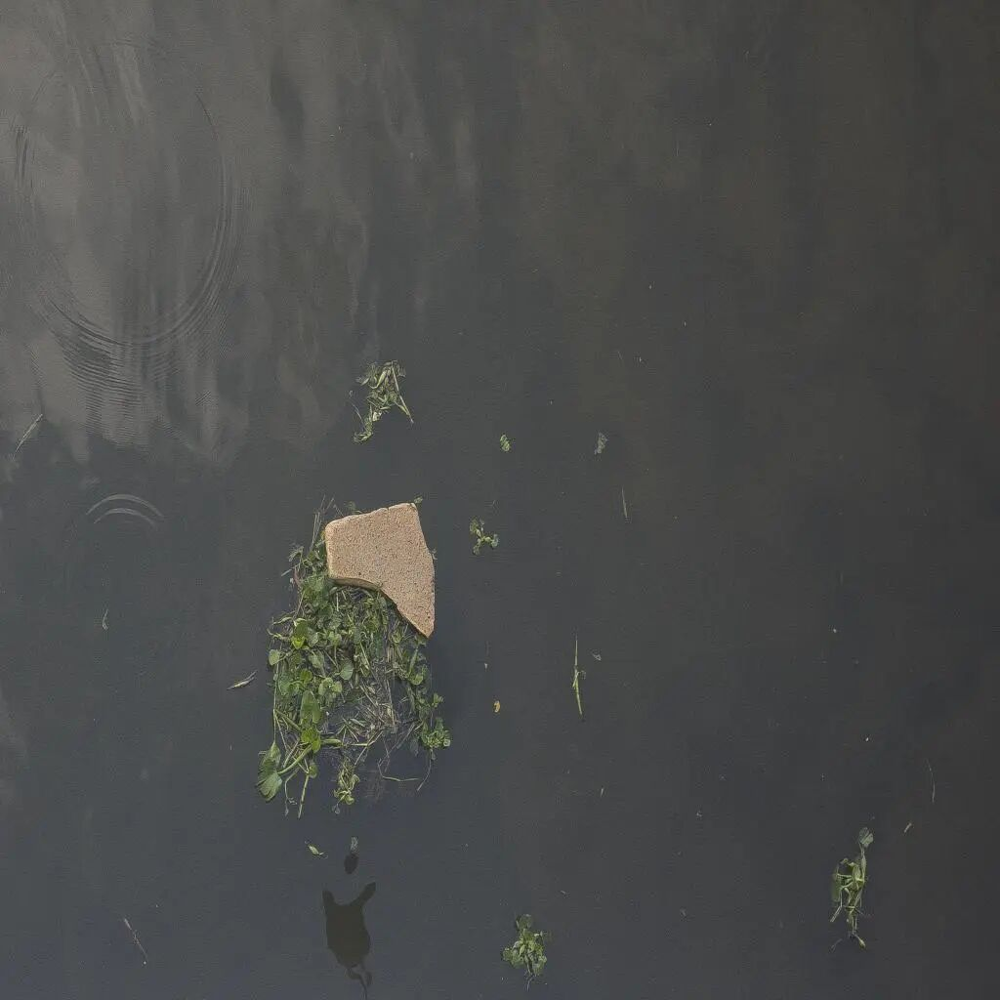

# Drone-View Aerial Photography Dataset for River Water Plastic Waste Detection in VOC+YOLO Format with 1320 Images and Enhanced Categories

Please note that the dataset contains a significant amount of enhancements. The original images are 110, while all other images were created by altering brightness contrast, adding noise, rotating, etc.

Dataset format: Pascal VOC format + YOLO format (txt file without split path, only containing jpg images and corresponding VOC format xml files and yolo format txt files)

Number of images (number of jpg files): 1320

Number of annotations (number of xml files): 1320

Number of annotations (number of txt files): 1320

Label category count: 1

Label category name: ["plastic_trash"]

Number of boxes and the number of images occupied by each category:

plastic_trash frame count = 11895, occupying picture count = 1320

Total frame count: 11895

Image resolution: 1024x1024

Using labelImg:

Annotation rules: Draw a rectangle around the category.

Important Notice: The dataset does not have separate training, validation, and test sets; you need to partition them yourself.

Special : This dataset does not guarantee the accuracy of the trained models or weight files.

Image Preview:

Annotation example:

Single image:

## Payment

Here is a pay link on Stripe ( https://buy.stripe.com/3cs8yP7sY87d0vu9AB ). Please contact me lonlonago@foxmail.com after funding $89, and I will send you a complete data files , thank you!

